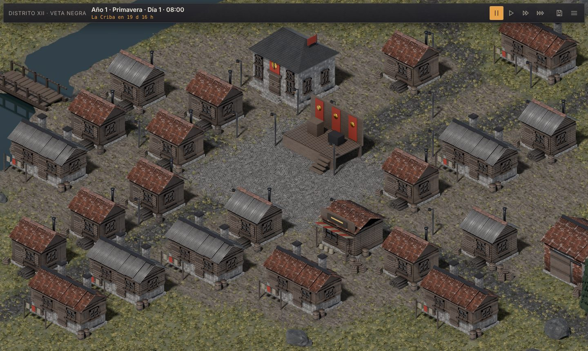
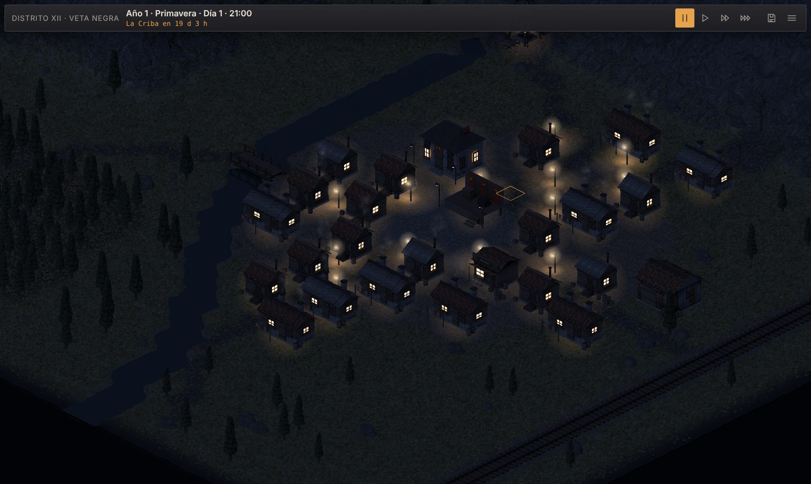
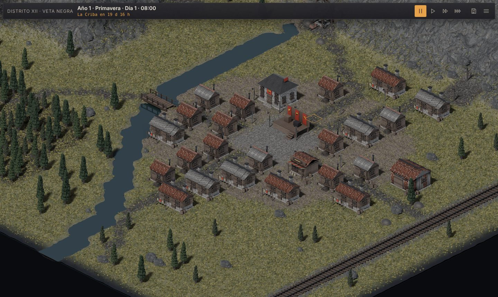
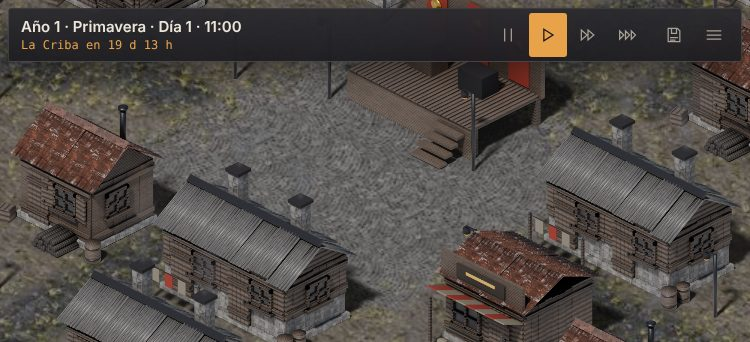

# DIEZMO

Videojuego de estrategia, gestión, simulación social y supervivencia para navegador (escritorio y móvil) y PWA.

Gobiernas el Distrito XII · Veta Negra, un valle minero bajo **la Concordia**, un régimen que cada año exige su diezmo: carbón… y dos de tus jóvenes para los Juegos del Diezmo en la capital, **Áurea**. Construyes una sociedad que conoces persona a persona, con familias, relaciones y generaciones, sabiendo que no puedes elegir a quién perderás. Gane quien gane, el distrito sigue vivo… y el año que viene habrá otra Criba.

> **Estado:** Fase 2 en curso (prototipo visual del distrito). El Distrito XII ya se ve: valle pre-renderizado, edificios y vegetación detallados, día y noche. Aún no hay mecánicas de construcción ni población. Estado real en [`docs/PROJECT_STATUS.md`](docs/PROJECT_STATUS.md).

| Día | Noche |
|---|---|
|  |  |

| El valle | iPhone (horizontal) | Menú |
|---|---|---|
|  |  |  |

## Jugar

- **Web:** `https://reenillaa.github.io/Hunger-Games/` (disponible cuando se active GitHub Pages; ver `docs/TASKS.md`, C-1).
- **iPhone:** abre la URL en Safari → Compartir → *Añadir a pantalla de inicio*.
- Herramientas de desarrollo: añade `?debug` a la URL.

## Desarrollo

Requisitos: Node ≥ 22.12. Para instalar dependencias **nuevas**, usa npm 11 (`npx npm@11 install …`): npm 10 tiene un bug con vitest 5. `npm ci` funciona con cualquiera.

```bash
npm ci
```

```bash
npm run dev
```

```bash
npm run verify
```

```bash
npm run build && npm run e2e
```

```bash
npm run sim -- --years 50 --seed 123
```

Pipeline de arte (opcional; Python 3.13 con `pip install bpy==5.3.0 pillow==11.3.0`). Los resultados ya están versionados en `public/assets/`; solo hace falta para regenerarlos:

```bash
python3 tools/art/fetch_textures.py
```

```bash
python tools/art/render_terrain.py --scale 1 --samples 16
```

```bash
python tools/art/render_district_assets.py --samples 40
```

## Documentación

| Documento | Para qué sirve |
|---|---|
| [GDD](docs/GDD.md) | Visión, pilares, bucles, estructura y alcance del juego |
| [GAME_SYSTEMS](docs/GAME_SYSTEMS.md) | Reglas, fórmulas y datos de cada sistema |
| [TECHNICAL_ARCHITECTURE](docs/TECHNICAL_ARCHITECTURE.md) | Stack, capas, rendimiento, guardado, despliegue |
| [ART_BIBLE](docs/ART_BIBLE.md) | Dirección artística, paletas, especificaciones y política de assets |
| [ROADMAP](docs/ROADMAP.md) | Fases, dependencias y criterios de finalización |
| [PROJECT_STATUS](docs/PROJECT_STATUS.md) | Qué existe y funciona hoy |
| [TASKS](docs/TASKS.md) | Tareas accionables con criterios de aceptación |
| [DECISIONS](docs/DECISIONS.md) | Decisiones, alternativas y motivos |
| [TESTING](docs/TESTING.md) | Estrategia de pruebas y registro de ejecuciones |

Tecnología: Phaser 4 · TypeScript 6 · React 19 · Vite 8 · Vitest · Playwright · IndexedDB · PWA · GitHub Actions · GitHub Pages.

## Propiedad intelectual

Universo, nombres, personajes y assets son originales o de licencia libre (CC0/CC-BY con atribución). El proyecto se inspira en conceptos de género (distopía, competición de supervivencia, simulación de colonias, táctica por turnos) sin usar marcas, personajes ni recursos protegidos de terceros. El nombre del repositorio es solo interno.
